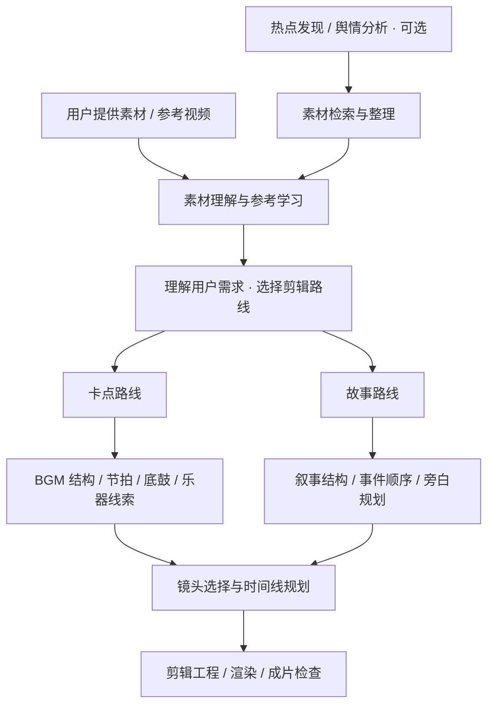

# 🐉 Bailong Video Agent · 白龙娘视频工作流

**把视频创作拆成可组合的 Agent、工具与流程。**

> 白龙娘还在整理，代码将按模块逐步开放。
>
> 这里先公开项目大纲、制作案例、提示词与流程说明。目录和入口文件先占位，后续逐步补充可独立使用的模块与示例。

从热点选题到素材理解，从音乐分析到剪辑规划，再到成片输出，Bailong Video Agent 围绕创作中的不同任务划分模块。可以从热点发现开始，也可以跳过这一步，直接带着素材和想法进入创作流程。

## 已公开的制作案例

### 01 · 《双城之战》32 秒群像卡点

围绕《life force》的音乐起音组织人物出场，用交错叠框、动作衔接、英文短句与原声混音完成 32 秒群像短片。

**[阅读案例：可复用提示词、六步流程与实际工具](docs/cases/arcane-life-force.md)**

成片规格：3840×2160 / 60fps / 32.33 秒。案例从用户素材开始，直接进入素材与音乐分析，跳过热点发现。

## 流程设计



这里的“学习”指对素材、参考视频和剪辑规律的分析与整理，不等同于训练模型。用户可以提供 5～10 个素材或参考片段作为起点，数量按项目需要调整。

## 模块地图

| 模块 | 关注的问题 | 预留入口 |
| --- | --- | --- |
| 热点分析 | 现在有什么值得做？讨论焦点、来源与时效是什么？ | `modules/trends/` |
| 素材整理 | 有哪些可用镜头？如何检索、归档、去重与保留来源？ | `modules/media/` |
| 参考学习 | 素材讲了什么？参考片段如何安排镜头、节奏和转场？ | `modules/learning/` |
| 需求理解 | 用户更重视卡点、叙事、角色、时长还是画幅？ | `modules/intent/` |
| 音频分析 | 节拍、段落、底鼓与乐器线索如何辅助剪辑？ | `modules/audio/` |
| 剪辑规划 | 哪个镜头适合哪个位置？如何组织故事或音乐段落？ | `modules/editing/` |
| 输出与检查 | 如何对接剪辑工程、渲染文件并检查成片？ | `modules/render/` |

以上为模块划分与开放范围设计，发布进度见 [开放清单](docs/roadmap.md)。

## 仓库结构

```text
bailong-video-agent/
├── packages/
│   └── bailong-video/
│       └── src/bailong_video/
│           ├── agent.py         # 总调度入口预留
│           ├── tools.py         # 工具注册入口预留
│           ├── pipeline.py      # 流程编排入口预留
│           ├── models.py        # 数据契约入口预留
│           └── modules/
│               ├── trends/      # 热点与舆情
│               ├── media/       # 素材检索与整理
│               ├── learning/    # 素材理解与参考分析
│               ├── intent/      # 创作需求与路线选择
│               ├── audio/       # 音乐与音频分析
│               ├── editing/     # 卡点与故事剪辑
│               └── render/      # 工程输出与成片检查
├── apps/                        # CLI、Web 等使用入口规划
├── workflows/                   # 可组合流程草案
├── examples/                    # 输入清单与配置示例
├── docs/                        # 架构、工具边界与开放进度
└── pyproject.toml               # Python 包安装配置
```

采用 monorepo 组织方式，当前 Python 库集中在 `packages/bailong-video`；应用入口、流程配置和文档在同一仓库维护。

## 代码开放方式

当前以项目说明和制作方法分享为主，Python 文件保留结构与入口。包骨架的安装配置见 [packages/bailong-video](packages/bailong-video/README.md)；具体工具的安装与调用方式会随对应代码一同发布。

## 从哪里开始阅读

- [架构与数据流](docs/architecture.md)：模块如何衔接，哪些步骤可以跳过。
- [工具目录](docs/tools.md)：卡点、故事与素材分析分别需要哪些工具。
- [开放清单](docs/roadmap.md)：当前公开内容与后续整理顺序。
- [流程配置](workflows/README.md)：从热点开始，或直接使用本地素材。
- [输入示例](examples/README.md)：如何描述素材、参考片段和创作需求。

## 素材与贡献

仓库只收录工程结构与项目自身内容，不附带影视片源、商业音乐、账号凭据或私人创作资料。素材来源、使用许可和署名信息应随素材记录保留。

欢迎通过 Issue 交流模块建议、输入输出设计与使用场景。提交贡献前请阅读 [贡献说明](CONTRIBUTING.md)。

**代码与文档许可：** [MIT](LICENSE)。该许可不覆盖外部素材、角色、音乐或第三方服务。

—— 爱剪视频的白龙娘 · maintained by [Thedan-1](https://github.com/Thedan-1)
